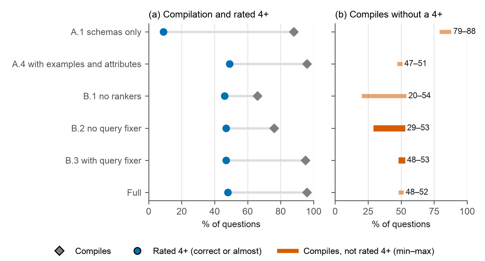
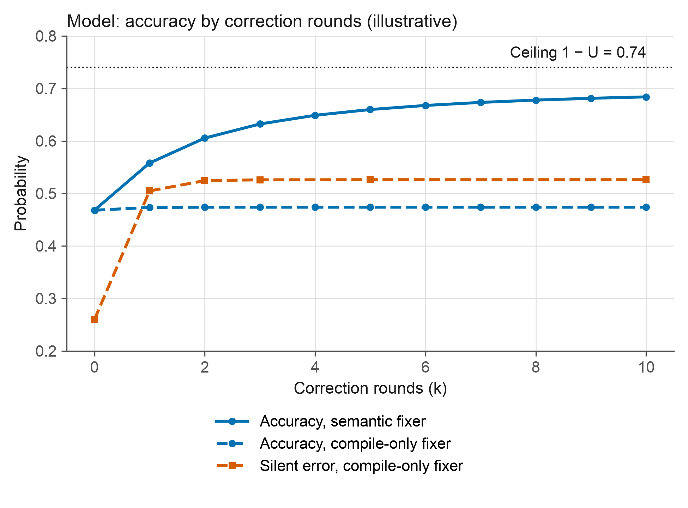

<div align="center">

# The self-correction ceiling

**What a deterministic validator cannot see in multi-agent text-to-SQL.**
In a retrieve -> generate -> validate -> correct pipeline whose corrector can send a query back to
retrieval, accuracy is bounded by `1 - U`, where `U` is the mass of errors the validator never
flags; without silencing, the corrector (`c`, `k`) changes how fast the bound is approached, not
the bound.

[](https://doi.org/10.5281/zenodo.24041990)
[](LICENSE)
[](LICENSES/CC-BY-4.0.txt)
[](.github/workflows/ci.yml)
[](tests/test_paper_numbers.py)
[](REPRODUCIBILITY.md)

`0.1.1` · concept DOI [10.5281/zenodo.24041990](https://doi.org/10.5281/zenodo.24041990) · [github.com/ulissesflores/self-correction-ceiling](https://github.com/ulissesflores/self-correction-ceiling)

</div>

> [!IMPORTANT]
> **Finding.** In the public ablation of the LinkedIn SQL Bot (Chen et al., 2025, Table 2; one run,
> LLM judge, no confidence intervals), adding the query fixer without the researcher agent
> (B.2 -> B.3, no return to retrieval) raised the share of queries that compile by **19 points**
> and the share rated 4+ by **0 points**. The silent error (compiles, not rated 4+) is not observed;
> the published totals only bound it: **29-53%** without the fixer and **48-53%** with it, a change
> between **-5 and +24** points. The firm statement is the second range: with the fixer, about half
> of all questions get a query that compiles without a 4+. Across the 13 configurations, compilation
> correlates 0.27 with the rated-4+ share and table recall 0.91. This is **consistent with** the
> closed-form ceiling of this repository; it does not prove it.

This repository is the companion package of a study of the accuracy ceiling of agentic
text-to-SQL pipelines. It ships the closed-form model with proofs, a Monte Carlo that serves as a
known-answer test of it, the arithmetic of the public ablation, four bilingual figures and a SHA-256
provenance chain. Scenarios of the model are **illustrative**: they are not fitted to the case.

**Paper.** The case study written with this package (Portuguese, APA 7; *O teto da autocorreção: o que o
validador não vê no SQL Bot multiagente do LinkedIn*), submitted on 2026-11-07 for the MIT 509 AI
Engineering course of the American Global Tech University, is in [`docs/paper/`](docs/paper/) exactly as
submitted: [PDF](docs/paper/flores-2026-teto-da-autocorrecao.pdf) (SHA-256 `554e403d93edbb3f…`) and its source
[DOCX](docs/paper/flores-2026-teto-da-autocorrecao.docx); full hashes in [`docs/paper/SHA256SUMS`](docs/paper/SHA256SUMS). Its numbers
are those of the sealed run `runs/v0.1.0`.

## What this contributes

1. **An absorbing ceiling for a pipeline with a (predominantly) deterministic validator.** With a return path to
   retrieval (`r > 0`) and no silencing, `A <= 1 - U`, `U = R(1-G)(1-d_g) + (1-R)(1-G0)(1-d_r)`
   (Proposition 1). Corollaries: without silencing, the corrector `(c, k)` sets the speed, not the ceiling; without a
   return to retrieval the ceiling falls to `R[G + (1-G)d_g] + (1-R)G0`; with silencing `e > 0`
   the limit is `c/(c+e)` of the flagged errors and, with false positives (`f b > 0`), more rounds
   can lower accuracy; a heterogeneity identity `E[A] - A(E[R], E[G]) = Cov(R, G)(S - d_g F)`.
   See [`docs/THEORY.md`](docs/THEORY.md).
2. **A known-answer test.** An event-level simulation that never calls the closed form agrees with
   it within sampling error in 8 runs (maximum |z| = 2.186).
3. **A confrontation with public numbers.** The arithmetic of Table 2 of Chen et al. (2025) read
   through the model, with the assumptions and the limits stated
   ([`data/linkedin_ablation.json`](data/linkedin_ablation.json)).

**Prior art.** The post-repair accuracy model and the idea of a ceiling set by coverage already
exist: Yang et al. (2025, EMNLP, [doi:10.18653/v1/2025.emnlp-main.685](https://doi.org/10.18653/v1/2025.emnlp-main.685)),
Reitich (2026, [arXiv:2604.18245](https://arxiv.org/abs/2604.18245)), Maamari et al. (2024, Table
Representation Learning workshop at NeurIPS,
[arXiv:2408.07702](https://arxiv.org/abs/2408.07702)) and, for coverage in dependability, Arnold
(1973, [doi:10.1109/T-C.1973.223703](https://doi.org/10.1109/T-C.1973.223703)). The contribution is to instantiate and
compose them for multi-agent text-to-SQL with a predominantly deterministic validator (the case extracts table names with an LLM), separating `R`, `G`, `d`,
`c`, `r`, `e` and `f`/`b`, and to confront the result with public numbers.

## At a glance

| Item | Value |
|---|---|
| Model | `retrieve -> generate -> validate -> correct`; parameters `R, G, G0, d_g, d_r, c, k, r, e, f, b` |
| Closed form | four additive parts, absorbing Markov chain per error ([`code/ceiling.py`](code/ceiling.py)) |
| Known-answer test | 4 parameter sets x 2 seeds x 200,000 questions, max abs z = 2.186 |
| Public evidence | Table 2 of arXiv:2507.14372 (13 configurations), Sections 3.3.4 and 4 |
| Published numbers | aggregated in [`output/results.json`](output/results.json), asserted in [`tests/test_paper_numbers.py`](tests/test_paper_numbers.py) |
| Seal | `environment -> code -> data -> scores -> figures`, RFC 6962 Merkle trees linked into one root |

## Quick start

```bash
python -m venv .venv && . .venv/bin/activate
python -m pip install -r requirements.txt
python make_provenance.py --verify   # integrity of the committed seal
python run_all.py                    # replication: regenerate, compare, test, verify
```

Expected end of `python run_all.py` (the pytest dots and the "wrote" lines omitted):

```text
[OK] results (0 s)
[OK] figures (pt) (1 s)
[OK] figures (en) (1 s)
[SAME] results.json
[SAME] figures/fig_anatomy_pt.png
  ... (the other fifteen figure files: SAME, or WARN if only the rasteriser differs)
[OK] tests (1 s)
[OK] chain verified: root <64 hex> · chain_head <64 hex>
[OK] provenance verify (0 s)
run_all: GREEN
```

## Results

The silent error `S` (compiles, not rated 4+) is bounded by the published totals `C` (compile) and
`Q` (rated 4+): `max(0, C - Q) <= S <= min(C, 100 - Q)`. The lower bound equals `S` only if every
query rated 4+ compiles; the ranges are computed on the published integers. `S` is not `U`: the
part of `U` not rated 4+ lies inside `S`, but the part the judge rates 4+ is not measured, so the
totals give no upper bound on `U` beyond the trivial `100 U <= C` (`C` is a percentage, `U` a
fraction).

| Step (Chen et al., 2025, Table 2) | Compile `C` | Rated 4+ `Q` | Identified range of `S` |
|---|---|---|---|
| B.2, without the query fixer | 76 | 47 | 29-53 |
| B.3, with the query fixer | 95 | 47 | 48-53 |
| A.1, only schemas | 88 | 9 | 79-88 |
| A.4, with the knowledge graph | 96 | 49 | 47-51 |



Illustrative scenario of the model (`R = 0.78`, `G = 0.60`, `G0 = 0`, `d_g = 0.45`, `d_r = 0.60`,
`r = 0.30`):

| Quantity | Value |
|---|---|
| No correction | 0.4680 |
| Ceiling `1 - U` (with a return to retrieval) | 0.7404 |
| Ceiling of the linear pipeline (`r = 0`) | 0.6084 |
| Semantic fixer (`c = 0.50`, `e = 0.05`), `k = 2` | 0.6054 |
| Compile-only fixer (`c = 0.03`, `e = 0.90`), `k = 2` | 0.4738 |
| Best number of rounds with false positives | 0 |



The other two figures are the intuition of the ceiling (`fig_anatomy`: what the validator sees) and
the write-query flow of the case with the proposed controls (`fig_architecture`). All figures exist
in English and Portuguese (`output/figures/*_en.*`, `*_pt.*`), as PNG and SVG; the claim behind each
one is in the docstring of [`scripts/make_figures.py`](scripts/make_figures.py).

## What is and isn't claimed

| Claimed | Not claimed | Frozen |
|---|---|---|
| Proposition 1 and its corollaries hold in the stated model | That any production system is described by the model | `output/results.json` and `output/figures/`, sealed |
| The arithmetic of Table 2 is as printed; the identified ranges follow from it without further assumptions; both are consistent with a ceiling set by what the validator cannot see | That the data prove the mechanism, or that the fixer is the cause (one run, one judge, no intervals) | `data/linkedin_ablation.json` (values copied from the page, with the PDF hash) |
| The model separates `R`, `G`, `d`, `c`, `r`, `e`, `f`/`b` | That the scenario parameters estimate the case, or that the idea of a coverage ceiling is new | The seal of `runs/v0.1.0/` |

## Integrity

A single SHA-256 chain seals environment, code, data, scores and figures; one altered byte changes
the root. Recompute it from disk at any time:

```bash
python make_provenance.py --verify
```

The root of the seal of `0.1.0` is the `root` field of `runs/v0.1.0/manifest.json`; the command
above prints it. `0.1.1` adds only the paper and metadata, so the seal is unchanged.

The mechanism, what it proves and what it does not are in [`REPRODUCIBILITY.md`](REPRODUCIBILITY.md).

## Layout

```text
code/                 model (ceiling.py), simulation (simulate.py), results (analysis.py),
                      vendored provenance tooling (provenance_chain.py, freeze_env.py)
scripts/              make_figures.py (claim map in the docstring)
data/                 linkedin_ablation.json (Table 2 and Sections 3.3.4 and 4, with locator)
docs/                 THEORY.md (statements, proofs, scope); paper/ (the submitted paper, PDF and
                      DOCX, with SHA256SUMS)
output/               results.json, figures/ (pt and en, PNG and SVG)
runs/                 sealed manifest, sha256sums.txt, CHAIN.jsonl
configs/stages.json   the stages of the chain
tests/                19 tests (numbers asserted, known-answer test, stage disjointness) plus
                      parametrized property checks of the proposition over a parameter grid
run_all.py            single entry point; make_provenance.py builds and verifies the seal
```

## Author

**Carlos Ulisses Flores**, Codex Hash Research Laboratory.
[](https://orcid.org/0000-0002-6034-7765)
[](https://ulissesflores.com)
[](http://lattes.cnpq.br/6905246706890561)

## Citation

Cite the concept DOI, [10.5281/zenodo.24041990](https://doi.org/10.5281/zenodo.24041990), which covers all versions and resolves to the
latest:

```bibtex
@software{flores_self_correction_ceiling,
  author  = {Flores, Carlos Ulisses},
  title   = {The self-correction ceiling: what a deterministic validator cannot see in
             multi-agent text-to-SQL},
  year    = {2026},
  version = {0.1.1},
  doi     = {10.5281/zenodo.24041990},
  url     = {https://doi.org/10.5281/zenodo.24041990}
}
```

The concept DOI is the one to cite for the project; each release also has its own version DOI,
listed on the Zenodo record (the `0.1.0-rc1` archive is [10.5281/zenodo.24041991](https://doi.org/10.5281/zenodo.24041991)). Machine-readable metadata:
[`CITATION.cff`](CITATION.cff), [`codemeta.json`](codemeta.json), [`.zenodo.json`](.zenodo.json).

## License

Dual: code under [Apache-2.0](LICENSE) (`LICENSES/Apache-2.0.txt`); text, figures and data under
[CC BY 4.0](LICENSES/CC-BY-4.0.txt). See [`NOTICE`](NOTICE) for third-party material that is not
redistributed.

## Anchor references

- Chen, A., et al. (2025). Text-to-SQL for enterprise data analytics.
  [arXiv:2507.14372](https://doi.org/10.48550/arXiv.2507.14372).
- Yang, Z., Zhang, Y., Wang, Y., Xu, Z., Lin, J., & Sui, Z. (2025). A probabilistic inference scaling
  theory for LLM self-correction. *Proceedings of EMNLP 2025*, 13573-13587.
  [doi:10.18653/v1/2025.emnlp-main.685](https://doi.org/10.18653/v1/2025.emnlp-main.685).
- Reitich, F. (2026). Correction and corruption: a two-rate view of error flow in LLM protocols.
  [arXiv:2604.18245](https://arxiv.org/abs/2604.18245).
- Maamari, K., Abubaker, F., Jaroslawicz, D., & Mhedhbi, A. (2024). The death of schema linking?
  Text-to-SQL in the age of well-reasoned language models. Table Representation Learning workshop,
  NeurIPS 2024. [arXiv:2408.07702](https://arxiv.org/abs/2408.07702).
- Arnold, T. F. (1973). The concept of coverage and its effect on the reliability model of a
  repairable system. *IEEE Transactions on Computers*, C-22.
  [doi:10.1109/T-C.1973.223703](https://doi.org/10.1109/T-C.1973.223703).
